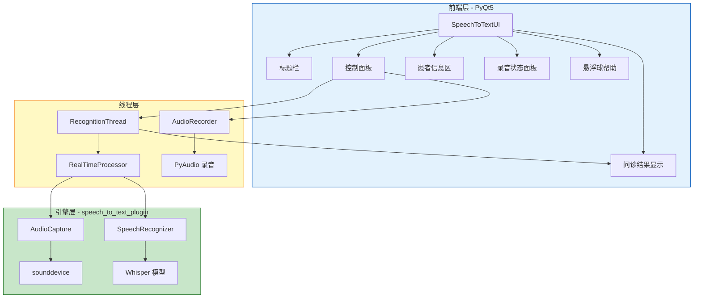
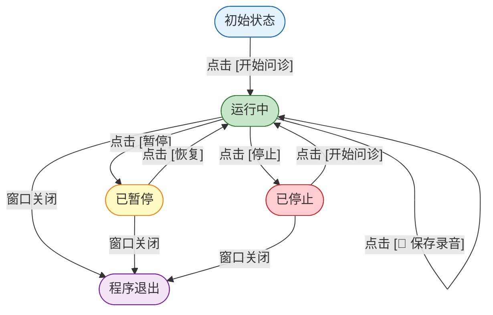
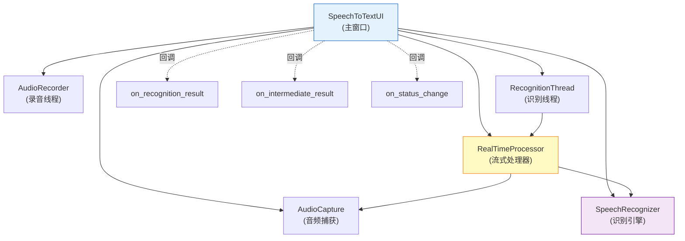

# 语音转文字问诊系统 

## 一、方案概述

### 1.1 项目目标

基于 `speech_to_text_ui_backup.py` 现有 UI 框架，构建一个功能完整、可实际运行的**实时语音转文字问诊系统**。

### 1.2 技术栈

| 层级 | 技术 | 作用 |
|------|------|------|
| GUI 框架 | PyQt5 5.x | 桌面端用户界面 |
| 音频捕获 | sounddevice | 实时系统音频流捕获 |
| 音频录制 | PyAudio | WAV 文件录音 |
| 语音识别 | Whisper Large-V3 | 深度学习语音识别模型 |
| 音频处理 | NumPy | 音频数据处理与归一化 |
| 后台线程 | QThread / threading | 异步多线程处理 |
| 运行环境 | Python 3.9 | 解释器 |

### 1.3 项目文件结构

```
WP\                                    （原始工作目录，GUI 代码未随本仓库归档）
├── speech_to_text_ui_backup.py    # 前端 GUI（主窗口）
├── speech_to_text_plugin.py       # 后端引擎（音频捕获、识别、流式处理）
├── 优化说明文档.md                 # 系统优化记录
├── 流式处理机制说明.md             # 流式处理技术文档
├── 悬浮球组件说明.md              # 悬浮球组件文档
└── 实施方案.md                    # 本文件
```

### 1.4 架构图



---

## 二、界面布局设计

### 2.1 整体布局结构

```
┌──────────────────────────────────────────────────────────┐
│  [标题栏] ✅ 实时语音转文字问诊系统              v2.0    │
├──────────────────────────────────────┬───────────────────┤
│  [患者信息区]                        │  [录音状态面板]    │
│  姓名：[________] 年龄：[___]        │  🟢 录音中        │
│  性别：[下拉选择] 编号：[_______]    │  ⏱ 00:12:35      │
│                                      │  [💾 保存录音]    │
├──────────────────────────────────────┴───────────────────┤
│  [控制面板]                                              │
│  🎤 音频设备：[下拉选择] [🔄 刷新]                       │
│  [▶ 开始问诊] [⏸ 暂停问诊]                             │
│  ⚡ 识别状态：📍 正在流式监听...                         │
├──────────────────────────────────────────────────────────┤
│  [问诊结果区域]                          [💡 悬浮球]     │
│  📊 问诊结果                                             │
│  ┌────────────────────────────────────────────────────┐  │
│  │ 患者主诉膝盖疼痛已有三个月，加重一周...              │  │
│  │ 膝盖疼痛严重，影响正常行走，需要拍片检查...          │  │
│  │                                                     │  │
│  └────────────────────────────────────────────────────┘  │
├──────────────────────────────────────────────────────────┤
│  [状态栏] ✅ 就绪                                        │
└──────────────────────────────────────────────────────────┘
```

### 2.2 界面元素清单

| 编号 | 控件类型 | 变量名 | 所在方法 | 行号 | 功能 |
|------|----------|--------|----------|------|------|
| 1 | QFrame | `title_bar` | `create_title_bar()` | L252 | 绿色渐变标题装饰条 |
| 2 | QLabel | `title_icon` | `create_title_bar()` | L259 | 标题图标 |
| 3 | QLabel | `title_label` | `create_title_bar()` | L267 | 标题文字 |
| 4 | QLabel | `version_label` | `create_title_bar()` | L276 | 版本号 |
| 5 | QTabWidget | `tab_widget` | `init_ui()` | L218 | 主标签页容器 |
| 6 | QWidget | `recognition_tab` | `create_recognition_tab()` | L291 | 识别标签页 |
| 7 | QGroupBox | `patient_group` | `create_patient_info_frame()` | L523 | 患者信息分组框 |
| 8 | QLineEdit | `patient_name_input` | `create_patient_info_frame()` | L546 | 患者姓名输入 |
| 9 | QLineEdit | `patient_age_input` | `create_patient_info_frame()` | L575 | 患者年龄输入 |
| 10 | QComboBox | `patient_gender_combo` | `create_patient_info_frame()` | L604 | 性别下拉（男/女） |
| 11 | QLineEdit | `patient_id_input` | `create_patient_info_frame()` | L654 | 患者编号输入 |
| 12 | QGroupBox | `control_group` | `create_modern_control_panel()` | L316 | 控制面板分组框 |
| 13 | QComboBox | `device_combo` | `create_modern_control_panel()` | L347 | 音频设备选择 |
| 14 | QPushButton | `refresh_btn` | `create_modern_control_panel()` | L361 | 刷新设备按钮 |
| 15 | QPushButton | `start_btn` | `create_modern_control_panel()` | L382 | 开始/停止问诊 |
| 16 | QPushButton | `pause_btn` | `create_modern_control_panel()` | L408 | 暂停/恢复按钮 |
| 17 | QGroupBox | `recording_status_group` | `create_integrated_recording_status_panel()` | L692 | 录音状态分组框 |
| 18 | QLabel | `recording_status_label` | L715 | 录音状态指示灯 |
| 19 | QLabel | `duration_label` | L741 | 录制时长显示 |
| 20 | QPushButton | `save_recording_btn` | L760 | 保存录音按钮 |
| 21 | QGroupBox | `real_time_group` | `create_modern_real_time_display()` | L442 | 结果显示分组框 |
| 22 | QTextEdit | `current_text` | L476 | 问诊结果文本框 |
| 23 | QLabel | `status_label` | L503 | 识别状态标签 |
| 24 | QStatusBar | `statusBar` | L209 | 底部状态栏 |
| 25 | QPushButton | `help_ball` | `create_help_floating_ball()` | L856 | 悬浮球帮助按钮 |

---

## 三、交互逻辑设计

### 3.1 核心状态机



### 3.2 按钮状态转换表

| 状态 | `start_btn` 文本 | `start_btn` 颜色 | `pause_btn` | `save_recording_btn` |
|------|-----------------|-------------------|-------------|---------------------|
| **就绪** | ▶ 开始问诊 | 绿色 | 禁用 | 禁用 |
| **运行中** | ⏹ 停止问诊 | 红色 | ✅ 橙色 - 已启用 | ✅ 启用 |
| **已暂停** | ⏹ 停止问诊 | 红色 | ▶ 继续问诊（绿色） | ✅ 启用 |
| **模型加载中** | 加载中... | 灰色 | 禁用 | 禁用 |

### 3.3 信号-槽连接表

| 信号发送者 | 信号 | 接收槽 | 触发时机 |
|-----------|------|--------|----------|
| `start_btn` | `clicked` | `toggle_recognition()` | 点击按钮 |
| `pause_btn` | `clicked` | `toggle_pause()` | 点击按钮 |
| `save_recording_btn` | `clicked` | `save_recording()` | 点击按钮 |
| `refresh_btn` | `clicked` | `refresh_devices()` | 点击按钮 |
| `AudioRecorder` | `duration_signal` | `on_duration_updated()` | 每秒 |
| `AudioRecorder` | `error_signal` | `on_recording_error()` | 错误时 |
| `RecognitionThread` | `result_signal` | `handle_result()` | 识别完成 |
| `RecognitionThread` | `status_signal` | `handle_status()` | 状态变更 |
| `RecognitionThread` | `intermediate_signal` | `handle_intermediate_result()` | 中间结果 |
| `help_ball` | 鼠标事件 | `on_ball_enter/leave/clicked` | 用户交互 |

### 3.4 关键交互流程

#### 3.4.1 开始问诊流程

```
用户点击 [开始问诊]
        │
        ▼
toggle_recognition()
        │
        ▼
start_recognition()
        │
        ├── 1. 验证患者信息（姓名非空）
        │       ├── 失败 → QMessageBox 提示，返回
        │       └── 通过 → 继续
        │
        ├── 2. 初始化音频捕获（AudioCapture）
        │
        ├── 3. 加载 Whisper 模型（如未加载）
        │
        ├── 4. 创建实时处理器（RealTimeProcessor）
        │       └── buffer_duration = 60.0
        │
        ├── 5. 设置回调函数
        │       ├── on_recognition_result → handle_result
        │       ├── on_intermediate_result → handle_intermediate_result
        │       └── on_status_change → handle_status
        │
        ├── 6. 创建并启动 RecognitionThread
        │       ├── 连接 result_signal / status_signal / intermediate_signal
        │       └── thread.start()
        │
        ├── 7. 自动启动录音（_start_auto_recording）
        │       └── AudioRecorder.start()
        │
        ├── 8. 更新按钮样式
        │       ├── start_btn → "⏹ 停止问诊"（红色）
        │       ├── pause_btn → 启用（橙色）
        │       └── save_recording_btn → 启用
        │
        └── 9. 更新状态显示
                └── status_label → "正在流式监听..."
```

#### 3.4.2 暂停/恢复流程

```
用户点击 [暂停/恢复]
        │
        ▼
toggle_pause()
        │
        ├── 当前未暂停？
        │       │
        │       ├── 是 → 执行暂停
        │       │   ├── 设置 is_paused = True
        │       │   ├── 设置 silence_detected 标志
        │       │   ├── 断开音频回调
        │       │   ├── 更新按钮样式（橙色→绿色"继续问诊"）
        │       │   └── status_label → "已暂停"
        │       │
        │       └── 否 → 执行恢复
        │           ├── 设置 is_paused = False
        │           ├── 恢复音频回调
        │           ├── 更新按钮样式（绿色→橙色"暂停问诊"）
        │           └── status_label → "正在流式监听..."
```

#### 3.4.3 保存录音流程

```
用户点击 [💾 保存录音]
        │
        ▼
save_recording()
        │
        ├── 1. 检查录音数据
        │       ├── 无数据 → QMessageBox 警告，返回
        │       └── 有数据 → 继续
        │
        ├── 2. 获取患者信息
        │       ├── patient_name / age / gender / id
        │       └── 生成文件名：recording_时间戳_编号_姓名_性别_年龄.wav
        │
        ├── 3. 保存 WAV 文件
        │       └── AudioRecorder.save_to_wav(filepath)
        │
        ├── 4. 清空录音数据（继续录制新内容）
        │       └── audio_recorder.audio_data = []
        │
        ├── 5. 更新问诊结果显示
        │       ├── 💾 录音已保存：文件名
        │       ├── 患者信息
        │       ├── 文件大小 / 时长
        │       └── 文件路径
        │
        └── 6. 弹出成功提示
                └── QMessageBox.information()
```

#### 3.4.4 停止问诊流程

```
用户点击 [停止问诊] 或 关闭窗口
        │
        ▼
stop_recognition()
        │
        ├── 1. 停止识别线程
        │       ├── processor.stop()
        │       ├── thread.quit() + wait(3000)
        │       └── 强制终止（如超时）
        │
        ├── 2. 停止音频捕获
        │       └── audio_capture 清理
        │
        ├── 3. 自动停止录音
        │       └── _stop_auto_recording()
        │
        ├── 4. 更新按钮样式
        │       ├── start_btn → "▶ 开始问诊"（绿色）
        │       ├── pause_btn → 禁用
        │       └── save_recording_btn → 禁用
        │
        └── 5. 更新状态显示
                ├── status_label → "📍 未运行"
                └── statusBar → "已停止"
```

---

## 四、后端集成接口

### 4.1 核心类关系



### 4.2 AudioCapture 接口

| 方法/属性 | 类型 | 说明 |
|----------|------|------|
| `__init__(sample_rate=16000, block_duration=5.0)` | 构造函数 | 初始化音频捕获，5秒块 |
| `start_capture()` | 方法 | 启动音频流 |
| `stop_capture()` | 方法 | 停止音频流 |
| `get_audio_chunk(timeout=1.0)` | 方法 | 获取一个音频块 |
| `list_devices()` | 静态方法 | 列出可用设备 |
| `on_audio_chunk` | 回调属性 | 音频块到达时的回调 |
| `sample_rate` | 属性 | 采样率（16000 Hz） |

### 4.3 SpeechRecognizer 接口

| 方法/属性 | 类型 | 说明 |
|----------|------|------|
| `__init__(model_name_or_path)` | 构造函数 | 加载 Whisper 模型路径 |
| `load_model()` | 方法 | 加载模型权重 |
| `transcribe(audio)` | 方法 | 识别语音，返回 `{'text', 'duration', 'processing_time'}` |
| `_post_process_text(text)` | 方法 | 后处理文本（去重复、标点优化） |
| `_is_hallucination(text)` | 方法 | 幻觉检测（18条规则） |
| `_filter_repetitions(text)` | 方法 | 过滤重复内容 |

### 4.4 RealTimeProcessor 接口

| 方法/属性 | 类型 | 说明 |
|----------|------|------|
| `__init__(audio_capture, recognizer, buffer_duration)` | 构造函数 | 初始化流式处理器 |
| `start()` | 方法 | 启动流式处理 |
| `stop()` | 方法 | 停止流式处理 |
| `transcribe_now(duration=30.0)` | 方法 | 立即录制并识别 |
| `detect_silence(audio, threshold_db)` | 方法 | 静音检测 |
| `on_recognition_result` | 回调属性 | 最终结果回调 |
| `on_intermediate_result` | 回调属性 | 中间结果回调 |
| `on_status_change` | 回调属性 | 状态变更回调 |

### 4.5 数据流接口

**回调数据结构 — 最终结果（RecognitionThread.result_signal）：**

```python
{
    'text': str,                    # 累积的完整文本
    'is_final': True,               # 标记为最终结果
    'timestamp': float,             # 时间戳
    'duration': float,              # 音频时长（秒）
    'processing_time': float,       # 处理耗时（秒）
    'speed_factor': float           # 处理速度倍数
}
```

**回调数据结构 — 中间结果（RecognitionThread.intermediate_signal）：**

```python
{
    'text': str,                    # 本次新识别的文本片段
    'accumulated_text': str,        # 累积的所有文本
    'is_final': False,              # 标记为中间结果
    'timestamp': float,             # 时间戳
    'duration': float,              # 音频时长（秒）
    'audio_energy_db': float        # 音频能量（dB）
}
```

---

## 五、部署步骤

### 5.1 环境准备

**步骤 1：安装 Python 3.9**

```powershell
python --version
# 输出应为 Python 3.9.x
```

**步骤 2：安装依赖库**

```powershell
# 核心 GUI 库
pip install PyQt5

# 音频处理库
pip install pyaudio numpy sounddevice

# 语音识别（Whisper）
pip install openai-whisper torch

# Hugging Face（可选，用于模型下载）
pip install huggingface_hub
```

**步骤 3：验证安装**

```powershell
python -c "import PyQt5; print('PyQt5 OK')"
python -c "import pyaudio; print('PyAudio OK')"
python -c "import whisper; print('Whisper OK')"
python -c "import torch; print('PyTorch OK')"
```

### 5.2 模型下载

**步骤 4：设置 Hugging Face 镜像**

在 `speech_to_text_ui_backup.py:16-17`：

```python
os.environ['HF_ENDPOINT'] = 'https://hf-mirror.com'
os.environ['HF_HOME'] = os.environ.get('HF_HOME', os.path.expanduser('~/.cache/huggingface'))
```

**步骤 5：首次运行自动下载**

首次运行时，`init_model()` 会通过 `SpeechRecognizer.load_model()` 自动下载 Whisper Large-V3 模型权重。确保：

- 磁盘空间 >= 6GB（模型约 3GB）
- 网络连接正常
- 磁盘路径 `HF_HOME`（HuggingFace 缓存目录）存在且空间充足

### 5.3 配置文件调整

**步骤 6：检查关键参数**

| 参数 | 文件 | 行号 | 当前值 | 说明 |
|------|------|------|--------|------|
| 采样率 | plugin.py | - | 16000 Hz | 无需修改 |
| 缓冲时长 | ui_backup.py | L1270 | 60 秒 | 可调整 |
| 最大处理时长 | plugin.py | L651 | 30 秒 | 可调整 |
| 静音阈值 | plugin.py | L657 | 5 秒 | 可调整 |

### 5.4 启动运行

**步骤 7：启动应用程序**

```powershell
# 进入项目目录后启动
python speech_to_text_ui_backup.py
```

**步骤 8：预期启动流程**

```
1. 控制台输出："导入 PyQt5 成功"
2. 主窗口显示（1200×900）
3. 标题栏显示 "✅ 实时语音转文字问诊系统 v2.0"
4. 模型加载中（加载时间 5-30 秒，取决于硬件）
5. 底部状态栏："✅ 就绪"
6. 音频设备下拉列表自动填充
```

---

## 六、测试验证方法

### 6.1 功能测试清单

| 编号 | 测试项 | 操作步骤 | 预期结果 | 验证方法 |
|------|--------|----------|----------|----------|
| T01 | 窗口启动 | 运行 main() | 窗口正常显示，尺寸 1200×900 | 目视 |
| T02 | 设备列表 | 点击 [刷新] 按钮 | 下拉列表更新可用设备 | 目视 |
| T03 | 患者信息输入 | 输入姓名、年龄、选择性别、编号 | 各控件正常响应 | 目视 |
| T04 | 开始问诊 | 点击 [开始问诊] | 按钮变红，显示"正在流式监听..." | 目视 + 日志 |
| T05 | 语音识别 | 对着麦克风说话 | 实时显示识别结果 | 目视 + 日志 |
| T06 | 中间结果 | 观察控制台 | 输出"[渐进识别结果] xxx" | 控制台日志 |
| T07 | 暂停问诊 | 点击 [暂停] | 按钮变绿"继续问诊"，识别暂停 | 目视 |
| T08 | 恢复问诊 | 点击 [继续问诊] | 按钮变橙，识别恢复 | 目视 |
| T09 | 保存录音 | 点击 [💾 保存录音] | 弹出成功提示，结果显示保存信息 | 目视 + 文件检查 |
| T10 | 停止问诊 | 点击 [停止问诊] | 按钮变绿"开始问诊"，显示"未运行" | 目视 |
| T11 | 输入验证 | 不输入姓名点击开始 | 弹出警告"请输入患者姓名" | 目视 |
| T12 | 悬浮球点击 | 点击右下角蓝色悬浮球 | 弹出帮助对话框（480×520） | 目视 |
| T13 | 悬浮球拖拽 | 按住悬浮球拖动 | 悬浮球跟随鼠标移动 | 目视 |
| T14 | 悬浮球悬停 | 鼠标移到悬浮球上 | 放大到 1.1 倍，变浅蓝色 | 目视 |
| T15 | 悬浮球点击 | 点击悬浮球 | 变红色，弹出对话框 | 目视 |
| T16 | 窗口关闭 | 点击关闭按钮 | 停止识别和录音后关闭 | 目视 + 日志 |
| T17 | 长时间运行 | 连续运行 5 分钟 | 无崩溃，内存稳定 | 任务管理器 |
| T18 | 低音量识别 | 轻声说话 | 文本正常识别 | 目视 |
| T19 | 静音检测 | 停止说话 5 秒 | 日志输出"[静音检测] xx秒静音" | 控制台日志 |
| T20 | 防幻觉 | 播放静音音频 | 不产生无关文本 | 目视 + 控制台日志 |

### 6.2 性能测试指标

| 指标 | 目标值 | 测试方法 |
|------|--------|----------|
| 识别延迟 | < 2 秒 | 从说话到文本显示的时间差 |
| CPU 占用率 | < 50% | 任务管理器监控 |
| 内存占用 | < 3GB | 任务管理器监控 |
| 识别准确率 | > 90% | 对比标准朗读文本 |
| 幻觉发生率 | < 5% | 统计幻觉过滤日志 |
| 长时间稳定性 | 30 分钟无崩溃 | 持续运行测试 |

### 6.3 错误场景测试

| 场景 | 预期行为 |
|------|----------|
| 无麦克风设备 | 设备列表为空，提示"未检测到音频设备" |
| 模型加载失败 | 弹出错误提示，记录错误详情 |
| 录音数据为空 | 保存时弹出警告"没有录音数据可保存" |
| 磁盘空间不足 | 保存时捕获异常，提示磁盘空间不足 |
| 运行中关闭窗口 | 弹出确认对话框"是否确定停止并退出？" |
| 音频设备断开 | 尝试自动恢复，失败后提示用户 |

### 6.4 控制台日志验证

运行时应观察的控制台输出：

```
[OK] 音频捕获已启动，采样率：16000Hz，块长：3.0秒
[OK] 语音识别引擎加载完成
[OK] 流式实时处理已启动
[渐进识别] 新音频段：5.2秒，能量：-25.3dB
[渐进识别结果] 患者膝盖疼痛三个月
[上下文校验] 校验通过
[静音检测] 检测到 5.0 秒静音
[防幻觉] 无义短语已过滤
[OK] 流式实时处理已停止
```

---

## 七、常见问题排查

| 问题 | 原因 | 解决方案 |
|------|------|----------|
| 导入 PyQt5 失败 | PyQt5 未安装 | `pip install PyQt5` |
| 录音功能不可用 | PyAudio 未安装 | `pip install pyaudio` |
| 模型下载失败 | 网络问题 | 检查 HF_ENDPOINT 设置，或手动下载 |
| `decode() got unexpected keyword argument` | Whisper API 不兼容 | 已修复，使用 `DecodingOptions` |
| 识别无输出 | 模型参数错误 | 已修复，移除无效 `DecodingOptions` 参数 |
| `[WinError 6] 句柄无效` | 音频设备释放异常 | 重启应用，检查音频设备 |

---

## 八、启动命令汇总

```powershell
# 1. 安装依赖
pip install PyQt5 pyaudio numpy sounddevice openai-whisper torch

# 2. 进入项目目录
# 3. 启动应用
python speech_to_text_ui_backup.py

# 4. 如果录音设备有问题，查看可用设备列表
python -c "from speech_to_text_plugin import AudioCapture; AudioCapture.list_devices()"
```