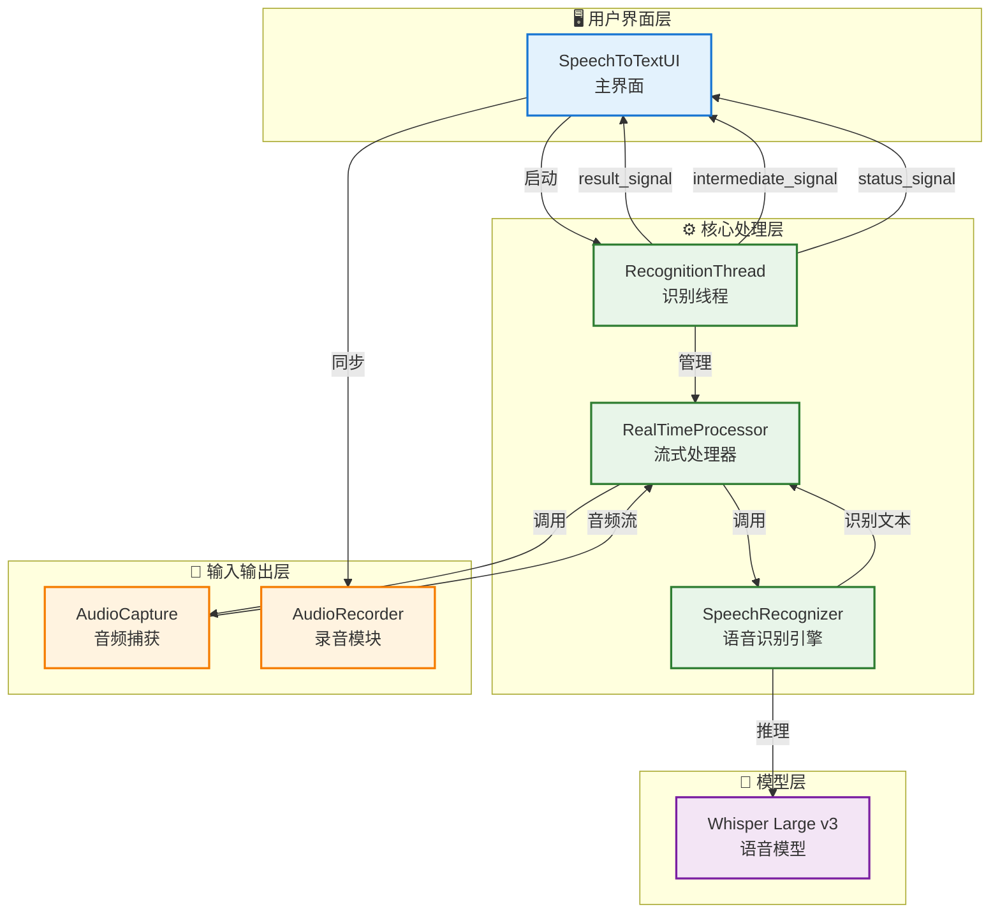
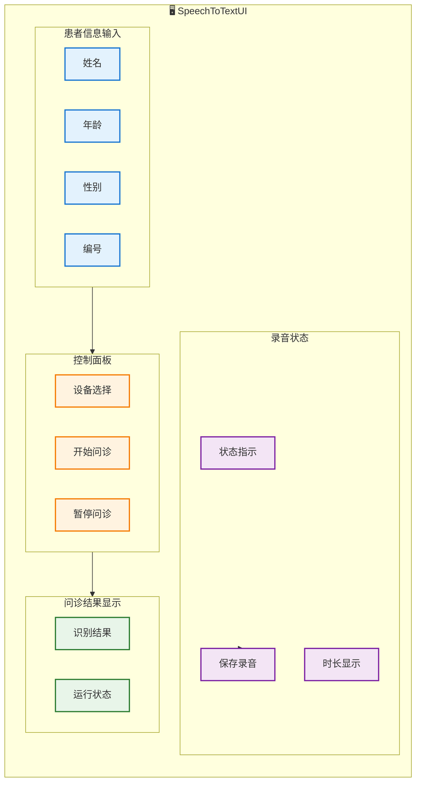
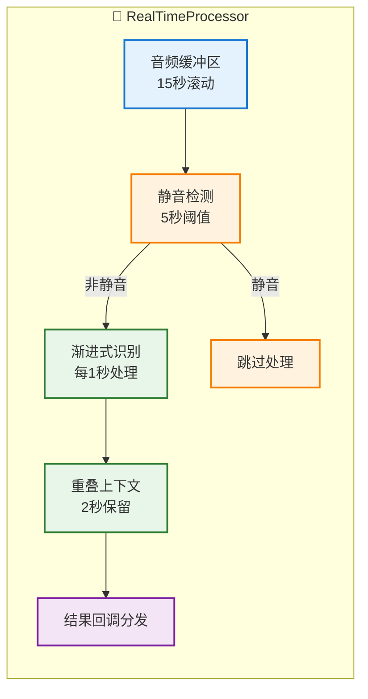
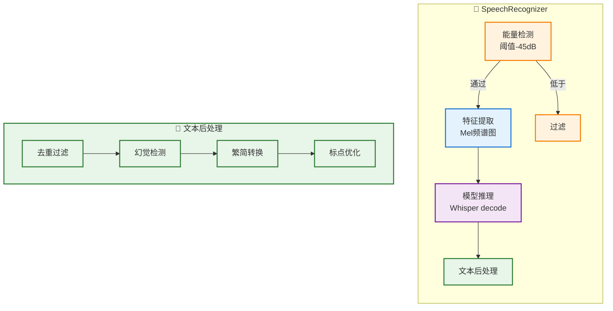
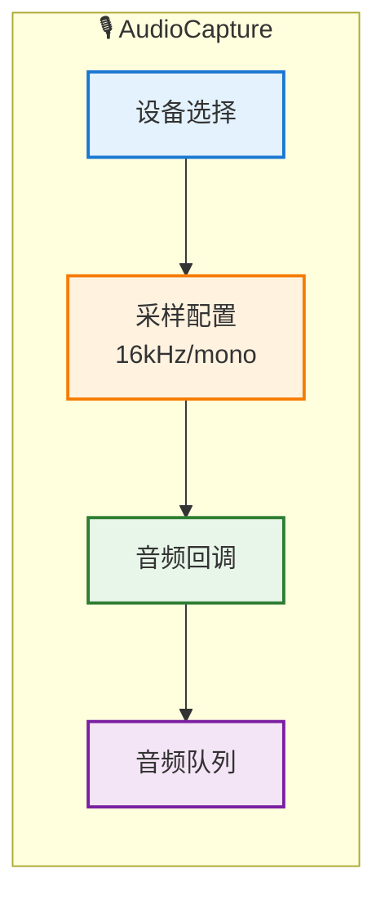
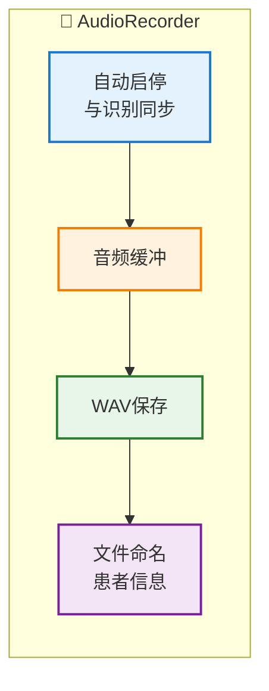
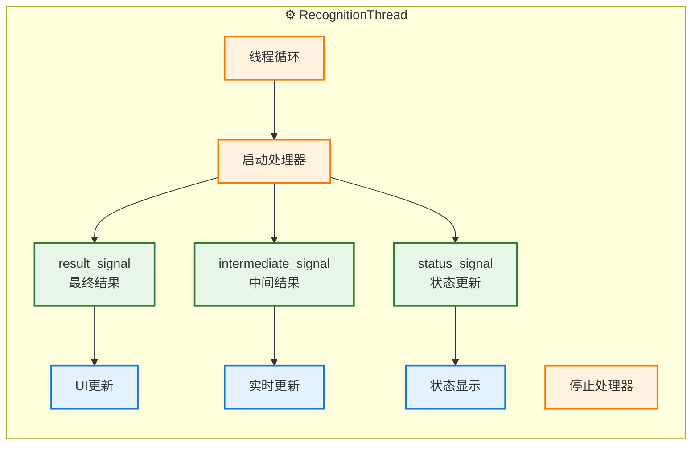
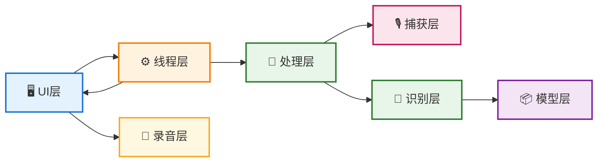

# 问诊系统主体框架流程图

## 文档说明

### 概述

本文档基于 PyQt5 框架的语音问诊系统代码实现，使用 Mermaid 语法绘制系统架构图和模块流程图，帮助开发者快速理解系统整体架构和各模块间的协作关系。


### 文档结构

| 章节 | 内容 |
|------|------|
| 系统架构总览 | 简化版四层架构图（UI/核心/IO/模型） |
| 模块子流程图 | 6 个核心模块的详细内部结构 |
| 核心数据流 | 从用户输入到结果显示的完整流程 |
| 模块关系图 | 各层之间的调用和依赖关系 |
| 核心模块说明 | 关键功能和参数表格说明 |
| 文件结构 | 项目文件组织说明 |

### 图形符号说明

| 符号 | 含义 |
|------|------|
| `-->` | 数据流/控制流方向 |
| `-.->` | 间接关联关系 |
| `subgraph` | 模块分组 |
| `classDef` | 颜色样式定义 |

### 颜色编码规范

| 颜色 | 含义 | 使用场景 |
|------|------|----------|
| 🔵 蓝色 (#e3f2fd) | 输入/UI 层 | 用户界面组件、输入控件 |
| 🟢 绿色 (#e8f5e9) | 核心处理 | 主要业务逻辑、处理流程 |
| 🟠 橙色 (#fff3e0) | 检测/线程 | 状态检测、线程控制 |
| 🟣 紫色 (#f3e5f5) | 识别/命名 | AI 识别模块、文件命名 |
| 🟡 黄色 (#fff8e1) | 录音控制 | 录音模块相关功能 |
| 🔴 红色 (#fce4ec) | 输入输出 | 硬件 I/O 接口 |

### 技术栈

| 技术 | 版本 | 用途 |
|------|------|------|
| PyQt5 | 5.15+ | GUI 框架 |
| PyAudio | - | 音频捕获 |
| PyTorch | 2.0+ | 深度学习框架 |
| Whisper | Large v3 | 语音识别模型 |
| Python | 3.8+ | 编程语言 |

### 阅读建议

1. **首次阅读** - 从"系统架构总览"开始，了解整体结构
2. **深入学习** - 按需查看对应的模块子流程图
3. **调试定位** - 参考"核心数据流"和"文件结构"定位代码

### 版本记录

| 版本 | 日期 | 说明 |
|------|------|------|
| v1.0 | 2025 | 初始版本，包含完整架构图和模块流程 |

---

## 系统架构总览（简化版）



---

## 模块详细子流程图

### 1. 用户界面层 (`SpeechToTextUI`)



### 2. 核心处理层 (`RealTimeProcessor`)



### 3. 语音识别层 (`SpeechRecognizer`)



### 4. 音频输入层 (`AudioCapture`)



### 5. 录音模块 (`AudioRecorder`)



### 6. 识别线程层 (`RecognitionThread`)



---

## 核心数据流


---

## 模块关系图



---

## 核心模块详细文档

### 模块 1: 用户界面层 (`SpeechToTextUI`)

#### 模块概述
负责系统人机交互界面的构建与用户输入管理，集成患者信息录入、设备选择、问诊控制、录音管理和结果展示功能。

#### 文件位置
`speech_to_text_ui_backup.py`（原始 GUI 代码，未随本仓库归档）

#### 核心职责
- 构建单行布局的患者信息输入区域（姓名、年龄、性别、编号）
- 管理问诊流程控制按钮（开始/暂停/保存）
- 统一展示识别结果和系统运行状态
- 处理录音自动启停逻辑
- 验证患者输入信息完整性

#### 关键方法

| 方法名 | 参数 | 返回值 | 功能说明 |
|--------|------|--------|----------|
| `start_recognition()` | 无 | 无 | 验证患者信息后启动问诊和自动录音 |
| `stop_recognition()` | 无 | 无 | 停止识别线程和自动停止录音 |
| `toggle_pause()` | 无 | 无 | 暂停/恢复问诊，切断/恢复音频回调 |
| `save_recording()` | 无 | 无 | 保存录音为WAV文件，不清空缓冲区 |
| `on_recognition_result(text)` | `text: str` | 无 | 接收最终识别结果并更新UI |
| `on_intermediate_result(text)` | `text: str` | 无 | 接收中间结果并实时显示 |
| `on_status_update(status)` | `status: str` | 无 | 更新系统状态显示 |

#### 输入验证规则

| 字段 | 验证条件 | 错误提示 |
|------|----------|----------|
| 姓名 | 非空 | "请输入患者姓名" |
| 年龄 | 1-150之间的数字 | "请输入有效年龄" |
| 性别 | 必须选择（男/女） | "请选择患者性别" |
| 编号 | 非空 | "请输入患者编号" |

#### 信号连接

```python
self.recognition_thread.result_signal.connect(self.on_recognition_result)
self.recognition_thread.intermediate_signal.connect(self.on_intermediate_result)
self.recognition_thread.status_signal.connect(self.on_status_update)
```

#### UI 布局结构
```
主布局 (垂直)
├── 顶部工具栏 (标题 + 版本号)
├── 患者信息行 (水平)
│   ├── 姓名输入框 (160px)
│   ├── 年龄输入框 (50px)
│   ├── 性别下拉框 (90px)
│   └── 编号输入框 (150px)
├── 控制面板 (设备选择 + 开始/暂停/保存按钮)
└── 统一显示区域 (占位1)
    ├── 识别结果文本 (居中)
    └── 状态栏 (底部)
```

#### 技术要点
- 使用 `QComboBox` 实现性别选择，需配套 `QAbstractItemView` 样式避免下拉列表异常
- 暂停功能通过设置 `audio_capture.on_audio_chunk = None` 断开音频回调
- 保存录音不中断录制，使用 `audio_recorder.save_recording()` 直接写入文件

---

### 模块 2: 核心处理层 (`RealTimeProcessor`)

#### 模块概述
管理音频流的渐进式识别流程，实现滑动窗口机制、静音检测、上下文保留和结果回调分发。

#### 文件位置
`speech_to_text_plugin.py` - `RealTimeProcessor` 类

#### 核心职责
- 维护 15 秒滚动音频缓冲区
- 每 1 秒处理一次新音频段
- 保留 2 秒重叠上下文避免边界丢失
- 实现 5 秒静音检测自动跳过
- 协调识别器调用和结果累积

#### 关键参数

| 参数名 | 类型 | 默认值 | 说明 |
|--------|------|--------|------|
| `buffer_size` | int | 15 | 音频缓冲区大小（秒） |
| `process_interval` | float | 1.0 | 处理间隔（秒） |
| `overlap_duration` | float | 2.0 | 重叠上下文时长（秒） |
| `silence_threshold_duration` | float | 5.0 | 静音判定阈值（秒） |
| `sample_rate` | int | 16000 | 采样率（Hz） |

#### 关键方法

| 方法名 | 参数 | 返回值 | 功能说明 |
|--------|------|--------|----------|
| `_streaming_process_loop()` | 无 | 无 | 主处理循环，持续运行直到停止标志 |
| `_on_audio_chunk(chunk)` | `chunk: np.ndarray` | 无 | 音频数据接收回调 |
| `_detect_silence()` | 无 | `bool` | 检测当前缓冲区是否为静音 |
| `_process_current_buffer()` | 无 | `str` | 调用识别器并返回文本 |
| `stop()` | 无 | 无 | 设置停止标志，终止处理循环 |

#### 内部状态变量

| 变量名 | 类型 | 说明 |
|--------|------|------|
| `audio_buffer` | `np.ndarray` | 滚动音频缓冲区 |
| `last_processed_position` | int | 上次处理位置索引 |
| `silence_detected` | bool | 静音状态标志 |
| `accumulated_text` | str | 累积的识别结果文本 |
| `is_running` | bool | 运行状态标志 |

#### 处理流程逻辑

```
音频输入 → _on_audio_chunk
         ↓
    更新 audio_buffer
         ↓
    等待 process_interval (1秒)
         ↓
    计算新音频段 [last_processed_position : current_position]
         ↓
    _detect_silence() → 静音? → 跳过处理
         ↓ 非静音
    调用 SpeechRecognizer.transcribe()
         ↓
    累积文本: accumulated_text += " " + recognized_text
         ↓
    更新 last_processed_position = current_position
         ↓
    触发回调分发结果
```

#### 技术要点
- 使用 `np.roll()` 实现缓冲区滚动，保持固定长度
- 重叠上下文通过 `max(0, last_processed_position - overlap_samples)` 计算起始位置
- 静音检测通过计算音频能量并对比阈值实现

---

### 模块 3: 语音识别层 (`SpeechRecognizer`)

#### 模块概述
执行原始音频到文本的转换，包含能量检测、特征提取、Whisper 模型推理和全面的文本后处理（含9项幻觉检测规则）。

#### 文件位置
`speech_to_text_plugin.py` - `SpeechRecognizer` 类

#### 核心职责
- 低能量音频过滤（-45dB 阈值）
- Mel 频谱图特征提取
- Whisper Large v3 模型推理
- 识别结果后处理和幻觉过滤

#### 关键参数

| 参数名 | 类型 | 默认值 | 说明 |
|--------|------|--------|------|
| `energy_threshold` | float | -45 | 能量检测阈值（dB） |
| `model_size` | str | "large-v3" | Whisper 模型版本 |
| `device` | str | "cuda"/"cpu" | 推理设备 |
| `language` | str | "zh" | 识别语言（中文） |

#### 关键方法

| 方法名 | 参数 | 返回值 | 功能说明 |
|--------|------|--------|----------|
| `transcribe(audio)` | `audio: np.ndarray` | `str` | 主识别入口，返回处理后文本 |
| `_energy_detection(audio)` | `audio: np.ndarray` | `bool` | 检测音频是否有效 |
| `_extract_mel_spectrogram(audio)` | `audio: np.ndarray` | `torch.Tensor` | 提取 Mel 频谱图 |
| `_is_hallucination(text)` | `text: str` | `bool` | 9项幻觉检测规则判断 |
| `_simplify_chinese(text)` | `text: str` | `str` | 繁体转简体 |
| `_optimize_punctuation(text)` | `text: str` | `str` | 标点符号优化 |

#### 幻觉检测规则（9项）

| 规则编号 | 检测模式 | 示例关键词 | 触发条件 |
|----------|----------|------------|----------|
| 1 | 重复检测 | 任意重复短语 | 连续重复≥2次 |
| 2 | 纯标点符号 | "，。！？" | 无实际文字内容 |
| 3 | 语气词 | "嗯 啊 哦 呃" | 仅包含语气词 |
| 4 | 极短文本 | 单个字 | 长度≤1个字符 |
| 5 | 乱码检测 | "的的的啊啊" | 无意义字符组合 |
| 6 | 视频推广 | "感谢观看 点赞 订阅 转发 打赏" | 包含推广关键词 |
| 7 | 频道名称 | "明镜.*栏目 点点.*栏目" | 包含频道名称模式 |
| 8 | 语义混合 | 医疗+娱乐关键词 | 同时包含两类词汇 |
| 9 | 无意义短语 | "下注 用手指夹住 时尚的问题" | 包含特定无意义短语 |

#### 处理流程

```
音频输入
    ↓
能量检测 (-45dB) → 低于阈值 → 返回空字符串
    ↓ 通过
提取 Mel 频谱图
    ↓
Whisper 模型推理 (decode)
    ↓
原始文本输出
    ↓
文本后处理管道:
    1. 去重过滤 (_is_hallucination 规则1,4,5)
    2. 幻觉检测 (_is_hallucination 规则2,3,6,7,8,9)
    3. 繁简转换 (_simplify_chinese)
    4. 标点优化 (_optimize_punctuation)
    ↓
最终识别文本
```

#### 技术要点
- 模型加载使用 `torch.load()` 加载本地 `.pth` 文件
- 能量计算: `10 * log10(mean(audio^2) + 1e-10)`
- 幻觉检测使用正则表达式 `re.search()` 匹配模式
- 繁简转换依赖 `opencc` 库（可选）

---

### 模块 4: 音频输入层 (`AudioCapture`)

#### 模块概述
负责从系统麦克风设备捕获实时音频流，配置采样参数，通过回调机制向处理器输送音频数据块。

#### 文件位置
`speech_to_text_plugin.py` - `AudioCapture` 类

#### 核心职责
- PyAudio 设备枚举和选择
- 配置 16kHz 单声道音频流
- 实现音频数据回调机制
- 管理音频流的启动和停止

#### 关键参数

| 参数名 | 类型 | 默认值 | 说明 |
|--------|------|--------|------|
| `sample_rate` | int | 16000 | 采样率（Hz） |
| `channels` | int | 1 | 声道数（单声道） |
| `chunk_size` | int | 1600 | 音频块大小（采样点数） |
| `device_index` | int | None | 设备索引（None=默认） |
| `format` | pyaudio.paFormat | paInt16 | 采样格式 |

#### 关键方法

| 方法名 | 参数 | 返回值 | 功能说明 |
|--------|------|--------|----------|
| `list_devices()` | 无 | `list` | 枚举可用音频输入设备 |
| `start(device_index)` | `device_index: int` | 无 | 启动音频流 |
| `stop()` | 无 | 无 | 停止音频流 |
| `_audio_callback(in_data, frame_count, time_info, status)` | 回调参数 | `(None, pyaudio.paContinue)` | 音频数据回调函数 |

#### 回调机制

```python
# 回调函数签名
def _audio_callback(self, in_data, frame_count, time_info, status):
    audio_data = np.frombuffer(in_data, dtype=np.int16)
    if self.on_audio_chunk:
        self.on_audio_chunk(audio_data)
    return (None, pyaudio.paContinue)
```

#### 数据流

```
麦克风硬件
    ↓
PyAudio 流 (16kHz, mono, 16bit)
    ↓
_audio_callback (每 100ms 触发)
    ↓
转换为 np.ndarray (int16)
    ↓
调用 on_audio_chunk 回调
    ↓
RealTimeProcessor._on_audio_chunk 接收
```

#### 技术要点
- 使用 `pyaudio.PyAudio()` 初始化音频系统
- `stream = p.open()` 配置非阻塞模式
- 回调函数必须返回 `(None, pyaudio.paContinue)` 保持流继续
- 设备列表通过 `p.get_device_count()` 和 `p.get_device_info_by_index()` 获取

---

### 模块 5: 录音模块 (`AudioRecorder`)

#### 模块概述
管理录音生命周期，实现与问诊识别同步的自动录音、WAV 文件保存和基于患者信息的智能文件命名。

#### 文件位置
`speech_to_text_plugin.py` - `AudioRecorder` 类

#### 核心职责
- 与问诊识别同步自动启动/停止录音
- 维护独立的录音缓冲区
- WAV 格式文件保存
- 基于患者信息生成文件名

#### 文件名格式
```
格式: YYYYMMDD_HHMMSS_编号_姓名_性别_年龄.wav
示例: 20250424_143025_P001_张三_男_45.wav
```

#### 关键方法

| 方法名 | 参数 | 返回值 | 功能说明 |
|--------|------|--------|----------|
| `start_recording(patient_info)` | `patient_info: dict` | 无 | 启动录音，接收患者信息 |
| `stop_recording()` | 无 | 无 | 停止录音 |
| `save_recording()` | 无 | `str` | 保存录音文件，返回文件路径 |
| `_on_audio_chunk(chunk)` | `chunk: np.ndarray` | 无 | 音频数据接收回调 |
| `_generate_filename(patient_info)` | `patient_info: dict` | `str` | 生成带患者信息的文件名 |

#### 录音状态管理

| 状态 | 触发条件 | 行为 |
|------|----------|------|
| 未启动 | 初始状态 | `audio_buffer = None` |
| 录音中 | `start_recording()` 调用后 | 持续追加音频数据 |
| 已保存 | `save_recording()` 调用后 | 写入文件，缓冲区不清空 |
| 已停止 | `stop_recording()` 调用后 | 停止接收音频数据 |

#### 文件命名逻辑

```python
def _generate_filename(self, patient_info):
    timestamp = datetime.now().strftime("%Y%m%d_%H%M%S")
    patient_id = patient_info.get('id', 'Unknown')
    name = patient_info.get('name', 'Unknown')
    gender = patient_info.get('gender', 'Unknown')
    age = patient_info.get('age', 'Unknown')
    return f"{timestamp}_{patient_id}_{name}_{gender}_{age}.wav"
```

#### 技术要点
- 使用 `wave` 模块写入 WAV 文件
- 参数: `nchannels=1, sampwidth=2, framerate=16000`
- 保存后不清空缓冲区，支持继续录制
- 患者信息通过字典传递: `{'id', 'name', 'gender', 'age'}`

---

### 模块 6: 识别线程层 (`RecognitionThread`)

#### 模块概述
在后台独立线程中管理整个识别流程，通过 Qt 信号机制向 UI 层异步传递识别结果、中间结果和状态更新。

#### 文件位置
`speech_to_text_ui_backup.py` - `RecognitionThread` 类

#### 核心职责
- 继承 `QThread` 实现后台异步处理
- 管理 `RealTimeProcessor` 的生命周期
- 通过 Qt 信号向 UI 层发送数据
- 协调音频捕获、处理和识别的线程同步

#### Qt 信号定义

| 信号名 | 参数类型 | 触发时机 | 用途 |
|--------|----------|----------|------|
| `result_signal` | `str` | 每次处理循环完成 | 发送最终累积识别结果 |
| `intermediate_signal` | `str` | 识别器返回文本时 | 发送中间识别结果用于实时显示 |
| `status_signal` | `str` | 状态变化时 | 发送系统状态文本 |

#### 关键方法

| 方法名 | 参数 | 返回值 | 功能说明 |
|--------|------|--------|----------|
| `run()` | 无 | 无 | 线程入口，启动处理器并进入循环 |
| `stop()` | 无 | 无 | 设置停止标志，安全退出线程 |
| `set_processor(processor)` | `processor: RealTimeProcessor` | 无 | 注入处理器实例 |
| `_on_result(text)` | `text: str` | 无 | 内部回调，触发 result_signal |
| `_on_intermediate(text)` | `text: str` | 无 | 内部回调，触发 intermediate_signal |

#### 线程生命周期

```
UI 调用 start_recognition()
    ↓
创建 RecognitionThread 实例
    ↓
创建 RealTimeProcessor 并注入
    ↓
创建 AudioCapture 并启动
    ↓
thread.start() → 进入 run()
    ↓
启动处理器 (processor.start())
    ↓
进入 _streaming_process_loop()
    ↓
循环处理音频 → 触发信号 → UI 更新
    ↓
UI 调用 stop_recognition()
    ↓
thread.stop() → thread.wait()
    ↓
线程安全退出
```

#### 信号连接示例

```python
# UI 层连接信号
self.recognition_thread.result_signal.connect(self.on_recognition_result)
self.recognition_thread.intermediate_signal.connect(self.on_intermediate_result)
self.recognition_thread.status_signal.connect(self.on_status_update)

# 处理器回调绑定
self.processor.on_result = self.recognition_thread._on_result
self.processor.on_intermediate = self.recognition_thread._on_intermediate
```

#### 技术要点
- 继承 `QThread` 必须重写 `run()` 方法
- 使用 `self.is_running` 标志控制循环退出
- 信号发射: `self.result_signal.emit(text)`
- 线程等待: `thread.wait()` 确保资源释放
- 暂停功能通过修改 `audio_capture.on_audio_chunk` 回调实现，不终止线程

## 文件结构

```
WP - 副本 (2)/
├── speech_to_text_ui_backup.py      # 主界面 (SpeechToTextUI)
├── speech_to_text_plugin.py         # 核心插件
│   ├── AudioCapture                 # 音频捕获
│   ├── SpeechRecognizer             # 语音识别
│   ├── RealTimeProcessor            # 流式处理
│   └── AudioRecorder                # 录音模块
└── whisper_large_v3_finetuned.pth   # Whisper 模型
```
